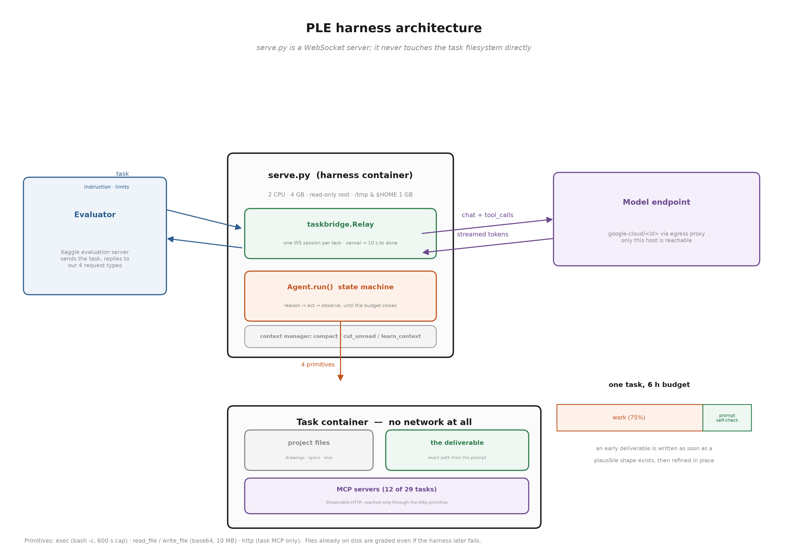

# `shihai-harness` — technical narrative

**Repository:** `https://github.com/AWEsome639/shihai-harness`
**Commit:** `b5b1ef625361edf386f6420ee1d18ab96f223f2b`

## 1. The entry

`shihai-harness` is a single-process Python 3.12 harness in four files: `serve.py` (1,973 lines), `taskbridge.py` (1,528, byte-identical to the organisers' `custom-openai` sample), `selfcheck.py` (1,099) and `contract.py` (805). It calls `google-cloud/claude-opus-5-5` through the OpenAI-compatible surface, marks `cache_control` on the system prompt and newest message, and pins `openai==3.26.1` / `websockets==15.0.1`. Four test scripts cover what needs no model: 45 checks (20 self-check cases, 7 contract cases, 8 wiring assertions, 10 G0 assertions), all passing here.

## 2. Architecture: one WebSocket server, four primitives

The evaluator starts `serve` in its own container and opens one WebSocket per task; the task's files sit in another container, reachable only through four requests: `exec` (a `bash -c`), `read_file`, `write_file` (base64, `append`, parents created) and `http` (only the task's MCP servers). Our tools map onto them: `bash`, `read_file`, `write_file`, and `edit_file` — the last a read-modify-write over the two file calls, because exact-string replacement is the edit shape models get right. Every tool returns a string and none raises; results are clipped at 30,000 characters.

Why that surface is enough: `exec` is a shell, so directory work and the task's own tooling (`ifcopenshell`, LibreOffice) need nothing new; base64 is the only lossless way to move a `.docx`; and `http` is the only route to MCP servers, which 12 of 29 dev tasks declare. Discovery is two-tier: up to 128 tools and 40,000 characters of schema JSON are exposed directly, beyond which the prompt carries a catalogue plus `mcp_find`/`mcp_call` — some `tools/list` responses run to hundreds of KB, which cannot be paid every turn.

Why no filesystem of its own: the harness container has a read-only root, 1 GB each of `/tmp` and `$HOME`, and no mount, network path or process in common with the task container. Deliverables are graded from the task disk, so a local copy would be a second source of truth that nothing grades and that can drift. The task image is also the only place with the libraries the work needs, and fair play forbids retaining task content. So the harness keeps one thing locally, the conversation; everything else is a request, and one process serves one connection.

## 3. Context management

### 3.1 Three levels, ordered by what they cost to lose

1. **Clip on arrival.** Every tool result is head/tail clipped at 30,000 characters; nothing larger enters the history.
2. **Trim what has been read.** Once `prompt_tokens > compact_at()`, tool results older than the last 12 results and over 600 characters are cut to 400, with a note that the tool can be re-run. Results after the last assistant turn are unread and never touched: deleting them makes the model think a command printed nothing.
3. **Summarise into notes.** If trimming is not enough, turns before the last six messages become one model-written note: requirements, what the files held, every file created or changed with path and state, the numbers and decisions, what remains. Skipped below ten messages; a failed summary keeps the history.
4. **Last resort, unread results.** On a context-full error, unread results over 1,200 characters are clipped to an equal share of the remaining window, floor 600, or halved when the window is unknown.

The 400 path uses that order: output tokens first, then read results, then unread ones.

### 3.2 Learning the window from a 400

The harness never calls `/models` and never guesses a window. On a context-full 400 it parses two numbers out of the error text — five wordings for the window, five for the prompt size. Three values follow: `room() = window − prompt − 1024`, `output_limit() = max(1024, min(ceiling, room))`, and `compact_at() = max(window/4, min(150000, window − room − 1024))`. On a 131,072-token window with a 32,000-token ceiling the threshold becomes 98,048 rather than the flat 150,000. The price is one wasted call per task; the benefit is that no threshold is hand-tuned per model.

### 3.3 Deadline clamping

`limits.agent_timeout_sec` is 21,600 s and the evaluator can cancel a run, so the deadline is enforced in five places: a `finish_margin` of 180 s (a quarter of a short task's budget); a loop-top check that stops opening tool turns below it and asks for the summary; every stream wrapped in `wait_for(left − reserve)`, keeping streamed text as `final_message` when the cut lands; backoff waits that stop before the margin instead of sleeping through it; and `bash` capped at `min(exec_timeout_sec, left − finish_margin)`, so no command eats the wrap-up window. The summary call gets `left − max(5 s, time_share(left, 30))`. Files on disk are graded even if the run fails, so each deliverable is written early.

## 4. The self-check loop

Two rules shaped this loop. Deliverables dominate every score, and constraint-plus-objective tasks score `s = 0.4p + 0.6GO'`, where one broken hard constraint sets `G = 0` and caps that item at 0.4. The official grader never ships in the task container — four of the nine statements we analysed say the workspace has no verifier or oracle — so the only mid-run feedback is what the harness derives from the statement itself.

### 4.1 G0: a contract read out of the statement

`contract.py` builds a contract before work starts: deliverables, archive members, closed value sets (`one of …`, `A|B|C`), named numeric columns. The task card's list is authoritative; prose adds the paths it lacks. Over the 29 dev statements it yields 73 deliverable entries, keeps every card entry, adds 16 from prose, and gives a concrete file path for 27 of 29. Nothing is guessed: an ambiguous path or vocabulary is omitted, since a wrong one would manufacture a false defect.

### 4.2 Four gates, one probe

`selfcheck.py` runs G1, G3, G4 and G7 against that contract, inside the task container:

- **G1 existence and type.** Exact path, regular file (not a directory or symlink), 0 < size ≤ 95 MiB — each a zero-score shape.
- **G3 the format parses.** CSV header and rows, JSON load, xlsx sheets, readable zip members, `ast.parse` for a script, `ISO-10303-21` for IFC, UTF-8 text; an HTML file named `.xlsx` fails.
- **G4 vocabulary and placeholders.** Enumerated columns stay inside the statement's set; numeric columns carry no `TBD`, `TBA`, `NaN`, `Inf` or `<fill in>`.
- **G7 delivery discipline.** The final message is non-empty and names every required deliverable.

The container side is one probe program sent on stdin, run as `python3 -`: one `stat` call, one `scan` call, one JSON line back. It reads only the listed paths and returns facts, never contents, so a 90 MiB deliverable costs a few hundred bytes. It knows no task: extensions, vocabularies and placeholders come from the contract. Findings return as one list, at most 12 per round, `fatal` → `fix` → `note`, one `fatal` per round so the fix that matters is not buried, each naming the statement violated and one action.

### 4.3 What it deliberately does not do

It does not estimate a score, imitate grader wording, or reimplement grader logic. It answers one question: can these
files be graded at all? That is also the fair-play line — graders and references are public for local scoring and the
harness must never read them, so a contract check derived only from the statement is the legal self-review. It is
fail-safe: it runs after the final answer and before `done`, and a missing contract, an exception or a timeout is logged
while `done` still goes out — asserted in `verify_wiring.py`, including a hung self-check cut by `asyncio.wait_for` with
the answer still returned.

### 4.4 Wiring status

`SELFCHECK` is off by default, so the dev A/B costs one environment variable rather than two code paths. When it is on, a
fatal finding is rendered by `feedback()` into the fixed payload shape, appended as a plain user message, and the work
loop runs once more, re-checks, and stops. Six guards bound it: at most `MAX_SELFCHECK_ROUNDS` (2); only `fatal` re-feeds,
so `note` and `fix` never restart the model; a repeated defect signature stops the loop; it does not start when the
remaining budget is under twice the finish margin; a raised or timed-out check returns the answer untouched; and with the
flag unset the path is identical to a harness without it. Fourteen assertions over a stubbed agent exercise the loop; whether a real model repairs a real deliverable from this
text is untested.

## 5. What the tasks look like

The 29 dev tasks are not one shape. The footprint per task directory runs from 34 to 3,180 files, of which `environment/` holds 7 to 3,162. The split is exact: 12 tasks declare MCP servers and ship no `filesystem/` at all — the container creates an empty `/filesystem` and the material lives in MCP-served applications — while the other 17 start with 6 to 124 project files. Grading differs: 14 rubric, 12 automated checks, 3 both; every task has a 360-minute limit.

Three consequences: layout cannot be assumed, so the model lists the workdir before working; the same four tools must serve file-first and app-first tasks, hence two-tier MCP discovery; and deliverable paths differ, hence a contract derived at run time.

## 6. Fair play

Beyond that, the harness never reads its own `artifacts/`, calls no host but the model endpoint, and
`model_api` matches the model actually called. Logs hold tool names, counts, timings and gate findings — never
instructions, file contents read back, or model messages; G0 records a count, not the paths. Nothing is written outside
the task container except the in-memory conversation.

## 7. Limitations

- **The dev set ran; the artifacts are real.** All 29 dev tasks produced an `artifacts/` entry and a `final_message.md`; the kit's review accepts 28 of 29 (one task, `foundation-strategy`, delivers a deliverable its grader does not read). The dev *score* is not yet available: the evaluator rejects `network_mode='no-network'` under `EnvironmentType.DOCKER`, so the graded run stops before scoring. Cost and effort below are therefore measured from the trajectories, not from a reward signal.
- **G2, G5, G6 unimplemented**: archive structure, arithmetic and cross-file joins, re-run determinism.
- **G3 has no `.docx` or `.pdf` reader**, and 14 of 29 tasks deliver a `.docx`; for those the gates cover existence, size and the final message only.
- **Two of 29 contracts carry only a directory.** For `fire-test-validation-memo` and `landscape-sheet-revision` the card declares `/app/files` and the statement says to save the answer under `output/`; G0 keeps a non-required directory entry, so the gates can note it but not check inside.
- **The re-feed is untested against a real model**: 14 stub assertions pass, but no run has shown a model repairing a deliverable from the text.

## 8. Figures 2 and 3

### Figure 2 — per-task effort (`fig2-score-vs-cost.png`)

One point per dev task: x is the agent's step count, y the input tokens the harness sent, estimated from the
trajectory's messages and observations at four characters per token, with one least-squares fit over the 29 tasks.
Effort runs about 1.4k input tokens per step. The spread is the useful part: tasks of equal length differ threefold in
cost, because reading a drawing set and re-reading a failed check are both "steps" but only one is expensive.

### Figure 3 — dev-set effort distribution (`fig3-dev-failure-distribution.png`)

Left, steps per task, 22 to 160, mode at 60–70 with a long right tail. Right, tool calls against steps: tightly
coupled, which is what a harness without a separate planner looks like.

The dominant failure this cycle is environmental, not difficulty. The evaluator rejects
`network_mode='no-network'` under the Docker provider, so the graded pass never reaches scoring and every run records
`score 0.0, complete False`. The harness itself completes: 29 of 29 tasks reach a `final_message`, and 28 of 29
artifact folders clear the kit's review. Closing that gap — everything runs, nothing is scored — is the one item that
must land before a hidden-set run means anything.
